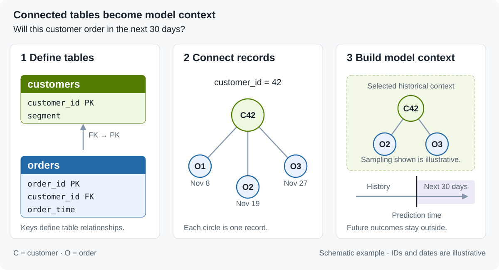

<p align="center">
  <picture>
    <source media="(prefers-color-scheme: dark)" srcset="assets/kumo-engine-dark.svg">
    <source media="(prefers-color-scheme: light)" srcset="assets/kumo-engine-light.svg">
    
  </picture>
</p>

<h1 align="center">Kumo Engine</h1>

<p align="center">
  <a href="https://pypi.org/project/kumo-engine/"></a>
  <a href="https://github.com/NVIDIA/kumo-engine/blob/main/LICENSE"></a>
  <a href="https://docs.nvidia.com/sdgm/kumo-engine/1.0.0/get-started-with-kumo-engine/overview"></a>
</p>

**An open accelerator for context generation over structured data.**

NVIDIA Kumo Engine prepares connected records and their history for predictive modeling at scale. Its Rust-based DiskGraph engine indexes data on local SSDs and retrieves time-correct neighborhoods for training and batch prediction, without keeping the full graph index in RAM.

Define your tables, relationships, and prediction task in Python. Kumo Engine handles ingestion, graph construction, context sampling, training, evaluation, and prediction.

For example, to predict whether a customer will order in the next 30 days, Kumo Engine connects the customer to their order history and samples eligible records as model inputs.

<picture>
  <source media="(max-width: 600px)" srcset="assets/model-context-mobile.svg">
  
</picture>

*Schematic example: the model plan determines sampling, and future outcomes remain outside the model inputs.*

**Benchmark highlight:** [One million three-hop neighborhoods in 19 seconds](https://docs.nvidia.com/sdgm/kumo-engine/1.0.0/resources/benchmarks).

 **[Documentation](https://docs.nvidia.com/sdgm/kumo-engine/1.0.0/get-started-with-kumo-engine/overview)**<br>
🛠️ **[Installation](#installation)**<br>
🚀 **[Quick Tour](#quick-tour)**<br>
📊 **[Benchmarks](#benchmarks)**

## Key Capabilities

- **Context at scale:** Retrieve connected records from an NVMe-backed graph index without keeping the full index in RAM.
- **End-to-end workflows:** Train and evaluate models, run batch predictions, generate embeddings, and save reloadable model bundles.
- **Production ready:** Ingest in parallel from S3, Snowflake, Databricks, BigQuery, and GCS.
- **Existing data and infrastructure:** Read files or connect to cloud storage and warehouses using existing compute and credentials.
- **Compatible with agentic workflows:** Agent skills let AI agents set up and run Kumo Engine workflows.

## Quick Tour

Predict which customers will order in the next 30 days using their connected order history. Try the [Python quickstart](packages/kumo-engine/README.md#quickstart) with the bundled sample dataset.

For complete walkthroughs, follow the [Google Colab](https://docs.nvidia.com/sdgm/kumo-engine/1.0.0/user-code-guide/code-examples/google-colab-notebook), [Snowflake](https://docs.nvidia.com/sdgm/kumo-engine/1.0.0/user-code-guide/code-examples/snowflake-notebook), or [Databricks](https://docs.nvidia.com/sdgm/kumo-engine/1.0.0/user-code-guide/code-examples/databricks-notebook) notebook. Explore more tasks in [Predictive Query Examples](https://docs.nvidia.com/sdgm/kumo-engine/1.0.0/get-started-with-kumo-engine/workflows-and-solutions/predictive-query-examples).

## Part of NVIDIA Kumo

NVIDIA Kumo is a family of open models, libraries, and tools for predictive AI across tabular, relational, and time-series data, and a core part of the NVIDIA Agent Knowledge Foundation.

- **NVIDIA Kumo Structured:** pretrained foundation models (Kumo Tabular, Kumo Relational, Kumo Forecast, and Kumo Anomaly) that make predictions without training a model per task. Refer to [NVIDIA/structured-data-models](https://github.com/NVIDIA/structured-data-models).
- **NVIDIA Kumo Engine (this repository):** an open accelerator for preparing connected structured data and training predictive models at production scale.

## Installation

The published **1.0.0 wheel** targets Linux x86-64 with glibc 2.34 or later and CPython 3.11 or later. The documented Linux setup uses Ubuntu 24.04 and Python 3.12. Prepare an NVIDIA GPU and local SSD working storage for the documented training workflows.

```bash
pip install kumo-engine
```

The base package reads local CSV and Parquet files. To read from a remote data source, install the matching optional dependency:

| Data Source | Installation |
| --- | --- |
| Amazon S3 | `pip install "kumo-engine[s3]"` |
| Google Cloud Storage | `pip install "kumo-engine[gcs]"` |
| BigQuery | `pip install "kumo-engine[bigquery]"` |
| Snowflake | `pip install "kumo-engine[snowflake]"` |
| Databricks | `pip install "kumo-engine[databricks]"` |

Refer to [prerequisites](https://docs.nvidia.com/sdgm/kumo-engine/1.0.0/get-started-with-kumo-engine/prerequisites) and [GPU sizing](https://docs.nvidia.com/sdgm/kumo-engine/1.0.0/get-started-with-kumo-engine/gpu-sizing) for a compatible runtime and storage capacity. Follow the setup guide for [Linux](https://docs.nvidia.com/sdgm/kumo-engine/1.0.0/get-started-with-kumo-engine/installation/linux-machine-deployment), [Snowflake notebooks](https://docs.nvidia.com/sdgm/kumo-engine/1.0.0/get-started-with-kumo-engine/installation/snowflake-notebook), or [Databricks notebooks](https://docs.nvidia.com/sdgm/kumo-engine/1.0.0/get-started-with-kumo-engine/installation/databricks-notebook). For an ARM64 source build, refer to the [DGX Spark guide](https://github.com/NVIDIA/kumo-engine/blob/main/packages/kumo-engine/dgx-spark.md).

## Benchmarks

### Context Generation on a 50-Billion-Node Graph

**One million starting entities**; synthetic graph: **50 billion nodes, 175.5 billion edges**:

| Sampling Depth | Kumo Engine | Prepared DuckDB |
| --- | --- | --- |
| 2 hops | **5 seconds** | 4.0 minutes |
| 3 hops | **19 seconds** | 5.3 minutes |
| 4 hops | **39 seconds** | 6.5 minutes |

Both ran with warm caches on one AWS i4i.32xlarge: 128 vCPUs, 1 TiB RAM, and 30 TB local NVMe. Kumo Engine's 2.6 TiB index exceeded RAM. Timings exclude preparation and model training. Initial preparation took 49.8 minutes for DiskGraph and 40.1 minutes for DuckDB.

### Training on Matched Hardware

On a separate 111-million-node citation graph, Kumo Engine completed 15 training/validation epochs in **41 minutes 14 seconds**, compared with **64 minutes 13 seconds** for matched-model PyG. Test accuracy was **63.26% versus 63.93%**; both used one g5.16xlarge with one A10G GPU.

Refer to the [full benchmark report](https://docs.nvidia.com/sdgm/kumo-engine/1.0.0/resources/benchmarks) for experimental scope, preparation costs, memory measurements, and additional comparisons. Results depend on the workload and configuration.

## Documentation and Interfaces

| Goal | Start Here |
| --- | --- |
| Connect data, define graphs, train, and predict | [User Code Guide](https://docs.nvidia.com/sdgm/kumo-engine/1.0.0/user-code-guide/set-up-a-graph/tables) |
| Configure sampling and training | [Model Plan Guide](https://docs.nvidia.com/sdgm/kumo-engine/1.0.0/user-code-guide/train-a-model/model-plan-guide) |
| Use the in-process Python API | [Local Python interface](https://github.com/NVIDIA/kumo-engine/blob/main/packages/kumo-engine/README.md), imported as `kumo.engine` |
| Use a configured Kumo service from Python | [Service client](https://github.com/NVIDIA/kumo-engine/blob/main/packages/kumo-sdk/README.md), imported as `kumoai_studio` |
| Run REST and the web UI on a single host | [Compose topology](https://github.com/NVIDIA/kumo-engine/blob/main/docker/compose/README.md) |
| Deploy the application on Kubernetes | [Application Helm chart](https://github.com/NVIDIA/kumo-engine/blob/main/helm/kumo-helm/README.md) |
| Explore deployment reference examples | [Helm examples and support boundary](https://github.com/NVIDIA/kumo-engine/blob/main/helm/README.md) |

For repository internals, refer to the [architecture](https://github.com/NVIDIA/kumo-engine/blob/main/ARCHITECTURE.md) and [engineering documentation index](https://github.com/NVIDIA/kumo-engine/blob/main/docs/README.md).

## Development and Support

Report bugs or documentation problems in [GitHub Issues](https://github.com/NVIDIA/kumo-engine/issues), including the affected path and observed behavior. Keep credentials and private deployment details out of reports.

This project is currently not accepting contributions.

<details>
<summary>Development guides and source-checkout validation</summary>

- [Setup and prerequisites](https://github.com/NVIDIA/kumo-engine/blob/main/docs/development/setup.md)
- [Testing and validation tiers](https://github.com/NVIDIA/kumo-engine/blob/main/docs/development/testing.md)
- [Public connector tests](https://github.com/NVIDIA/kumo-engine/blob/main/docs/development/public-tests.md)
- [Generated artifacts](https://github.com/NVIDIA/kumo-engine/blob/main/docs/development/generated-artifacts.md)
- [UI development](https://github.com/NVIDIA/kumo-engine/blob/main/docs/development/ui.md)
- [Agent instructions and setup](https://github.com/NVIDIA/kumo-engine/blob/main/docs/development/agents.md)
- [Review requirements](https://github.com/NVIDIA/kumo-engine/blob/main/docs/development/review.md)
- [In-tree local SDK validation example](https://github.com/NVIDIA/kumo-engine/blob/main/examples/sdk-local/README.md)

</details>

## License

Kumo-owned source is licensed under the [Apache License 2.0](https://github.com/NVIDIA/kumo-engine/blob/main/LICENSE). Vendored and incorporated third-party code retains its applicable licenses and attribution.

<details>
<summary>Component licenses and third-party attribution</summary>


Apache-licensed Python subprojects retain a copy of the root license at each package build root so it accompanies independently built wheels and source distributions. The nested component license files are:

| Component | License | License file |
| --- | --- | --- |
| `kumo-api` | Apache-2.0 | [packages/kumo-api/LICENSE](https://github.com/NVIDIA/kumo-engine/blob/main/packages/kumo-api/LICENSE) |
| `kumo-bigquery` | Apache-2.0 | [packages/kumo-bigquery/LICENSE](https://github.com/NVIDIA/kumo-engine/blob/main/packages/kumo-bigquery/LICENSE) |
| `kumo-core` | Apache-2.0 AND MIT | [packages/kumo-core/LICENSE](https://github.com/NVIDIA/kumo-engine/blob/main/packages/kumo-core/LICENSE), [third-party notice](https://github.com/NVIDIA/kumo-engine/blob/main/packages/kumo-core/THIRD-PARTY.txt) |
| `kumo-databricks` | Apache-2.0 | [packages/kumo-databricks/LICENSE](https://github.com/NVIDIA/kumo-engine/blob/main/packages/kumo-databricks/LICENSE) |
| `kumo-engine` (formerly `kumoai-local`) | Apache-2.0 | [packages/kumo-engine/LICENSE](https://github.com/NVIDIA/kumo-engine/blob/main/packages/kumo-engine/LICENSE) |
| `kumo-gcs` | Apache-2.0 | [packages/kumo-gcs/LICENSE](https://github.com/NVIDIA/kumo-engine/blob/main/packages/kumo-gcs/LICENSE) |
| `kumo-glove-6b-50d` | Apache-2.0 AND PDDL-1.0 | [tools/glove-6b-50d/LICENSE](https://github.com/NVIDIA/kumo-engine/blob/main/tools/glove-6b-50d/LICENSE), [third-party notice](https://github.com/NVIDIA/kumo-engine/blob/main/tools/glove-6b-50d/THIRD-PARTY.txt) |
| `kumo-pql` | Apache-2.0 | [packages/kumo-pql/LICENSE](https://github.com/NVIDIA/kumo-engine/blob/main/packages/kumo-pql/LICENSE) |
| `kumo-s3` | Apache-2.0 | [packages/kumo-s3/LICENSE](https://github.com/NVIDIA/kumo-engine/blob/main/packages/kumo-s3/LICENSE) |
| `kumo-sdk` (`kumoai-studio`) | Apache-2.0 AND BSD-3-Clause | [packages/kumo-sdk/LICENSE](https://github.com/NVIDIA/kumo-engine/blob/main/packages/kumo-sdk/LICENSE), [third-party notice](https://github.com/NVIDIA/kumo-engine/blob/main/packages/kumo-sdk/THIRD-PARTY.txt) |
| `kumo-snowflake` | Apache-2.0 | [packages/kumo-snowflake/LICENSE](https://github.com/NVIDIA/kumo-engine/blob/main/packages/kumo-snowflake/LICENSE) |
| Vendored Temporal Helm chart | MIT | [helm/kumo-temporal/charts/temporal/LICENSE](https://github.com/NVIDIA/kumo-engine/blob/main/helm/kumo-temporal/charts/temporal/LICENSE) |
| Vendored PtrHash | MIT | [packages/diskgraph/diskgraph-ptrhash/LICENSE](https://github.com/NVIDIA/kumo-engine/blob/main/packages/diskgraph/diskgraph-ptrhash/LICENSE) |
| Fabric Toolbox | MIT | [3rdparty/notices/fabric-toolbox-LICENSE](https://github.com/NVIDIA/kumo-engine/blob/main/3rdparty/notices/fabric-toolbox-LICENSE) |
| PyTorch Forecasting | MIT | [3rdparty/notices/pytorch-forecasting-LICENSE](https://github.com/NVIDIA/kumo-engine/blob/main/3rdparty/notices/pytorch-forecasting-LICENSE) |
| scikit-learn | BSD-3-Clause | [3rdparty/notices/scikit-learn-LICENSE](https://github.com/NVIDIA/kumo-engine/blob/main/3rdparty/notices/scikit-learn-LICENSE) |
| spaCy | MIT | [3rdparty/notices/spacy-LICENSE](https://github.com/NVIDIA/kumo-engine/blob/main/3rdparty/notices/spacy-LICENSE) |
| Starlette | BSD-3-Clause | [3rdparty/notices/starlette-LICENSE.md](https://github.com/NVIDIA/kumo-engine/blob/main/3rdparty/notices/starlette-LICENSE.md) |
| Temporal Python samples | MIT | [3rdparty/notices/temporal-samples-python-LICENSE](https://github.com/NVIDIA/kumo-engine/blob/main/3rdparty/notices/temporal-samples-python-LICENSE) |
| torchtext | BSD-3-Clause | [3rdparty/notices/torchtext-LICENSE](https://github.com/NVIDIA/kumo-engine/blob/main/3rdparty/notices/torchtext-LICENSE) |
| react-codemirror | MIT | [ui/third_party/npm-licenses/react-codemirror-4.25.10.LICENSE](https://github.com/NVIDIA/kumo-engine/blob/main/ui/third_party/npm-licenses/react-codemirror-4.25.10.LICENSE) |
| react-spacer | MIT | [ui/third_party/npm-licenses/react-spacer-1.3.0.LICENSE](https://github.com/NVIDIA/kumo-engine/blob/main/ui/third_party/npm-licenses/react-spacer-1.3.0.LICENSE) |
| format | MIT | [packages/kumo-ui-catalog/third_party/npm-licenses/format-0.2.2.LICENSE](https://github.com/NVIDIA/kumo-engine/blob/main/packages/kumo-ui-catalog/third_party/npm-licenses/format-0.2.2.LICENSE) |
| heap | PSF-2.0 | [packages/kumo-ui-catalog/third_party/npm-licenses/heap-0.2.5.LICENSE](https://github.com/NVIDIA/kumo-engine/blob/main/packages/kumo-ui-catalog/third_party/npm-licenses/heap-0.2.5.LICENSE) |
| pathfinding | MIT | [packages/kumo-ui-catalog/third_party/npm-licenses/pathfinding-0.4.18.LICENSE](https://github.com/NVIDIA/kumo-engine/blob/main/packages/kumo-ui-catalog/third_party/npm-licenses/pathfinding-0.4.18.LICENSE) |
| size-sensor | ISC | [packages/kumo-ui-catalog/third_party/npm-licenses/size-sensor-1.0.3.LICENSE](https://github.com/NVIDIA/kumo-engine/blob/main/packages/kumo-ui-catalog/third_party/npm-licenses/size-sensor-1.0.3.LICENSE) |
| toggle-selection | MIT | [packages/kumo-ui-catalog/third_party/npm-licenses/toggle-selection-1.0.6.LICENSE](https://github.com/NVIDIA/kumo-engine/blob/main/packages/kumo-ui-catalog/third_party/npm-licenses/toggle-selection-1.0.6.LICENSE) |

Third-party attribution is recorded in the [repository notice](https://github.com/NVIDIA/kumo-engine/blob/main/THIRD-PARTY.txt), [Python distribution notice](https://github.com/NVIDIA/kumo-engine/blob/main/KUMO-THIRD-PARTY.txt), [UI catalog notice](https://github.com/NVIDIA/kumo-engine/blob/main/packages/kumo-ui-catalog/THIRD-PARTY.txt), and [Helm stack notice](https://github.com/NVIDIA/kumo-engine/blob/main/helm/kumo-stack/THIRD-PARTY.txt).

</details>
