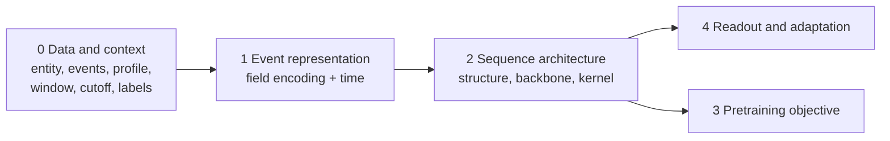

# Building blocks

This page maps the kit's five component slots. A model selects one choice per
slot. For how published systems fill the same slots, see the
[industry landscape](industry-landscape.md). For support tiers, see the
[compatibility matrix](../reference/compatibility-matrix.md); this page describes
the components and their contracts.

In the three-block teaching storyline, slots 0 and 1 are **tokenization**,
slots 2 and 3 are **model and objective**, and slot 4 is **downstream
adaptation**.

## The slots

### 0. Data and context

Decides what one training example is: whose events, from which sources, up to
which cutoff, and with which label.

| Component | Where | Notes |
|---|---|---|
| `TransactionEvent`, `EntityProfile`, `TransactionSequence` | `tfm.contracts.schema` | The data contract ([data-contract.md](data-contract.md)) |
| Adapters `synthetic`, `pragmatiq`, `tabformer` | `tfm.data.adapters` | Selected by `data.adapter`. Return events, profiles, and label rows |
| `build_entity_sequences`, `build_entity_windows` | `tfm.data.sequence_builders` | One history per entity at a cutoff, or tiled windows for pretraining |
| `build_sequences_at_label_cutoffs` | `tfm.data.sequence_builders` | One history per labelled row, cut at that row's timestamp |
| `assign_temporal_split`, `split_entities` | `tfm.data.splits` | Time cutoffs for pretraining, and entity-disjoint probe folds |
| `LabelWindow` | `tfm.data.labels` | The `(start, end]` period whose labels one side of a probe may read ([probe split rules](evaluation-protocol.md)) |

### 1. Event representation

Decides how one event's fields, and its time, become vectors. A tokenizer
declares a **layout**, which is the batch shape it produces.

| Component | Where | Layout | Field encoding | Time encoding |
|---|---|---|---|---|
| `transaction_field_tokenizer` | `tfm.features.tokenizers.financial` | `flat_fields` | One token per field (12 fields), `<sep>` between events | Year, month, day, hour, and weekday field tokens |
| `key_value_time` | `tfm.features.tokenizers.key_value_time` | `key_value_time` | PRAGMA key/value tokens: percentile bins for numbers, categories, byte-level text | `time_log`, `elapsed_log`, calendar ids beside the tokens |
| `flat_key_value` | `tfm.features.tokenizers.flat_key_value` | `flat_key_value` | Key-value-time vocabulary in one stream, `[EVT]` between events, profile prefix | Weekday, hour, and log-gap bucket tokens per event |
| `event_fields` | `tfm.features.tokenizers.event_fields` | `key_value_time` | The 12 flat-field tokens, grouped per event | `elapsed_log`, calendar ids |
| `NoPE` | `tfm.position` | | | No positional encoding (causal mask supplies order) |
| `RoPE` | `tfm.position` | | | Rotary positions over token index, applied inside the HuggingFace Llama backbone (required by it; the eager decoder refuses it) |
| `TimeRoPE` | `tfm.position` | | | Rotary encoding over continuous log-time |

### 2. Sequence architecture

Decides how events are arranged, and what reads them.

| Component | Where | Structure | Backbone |
|---|---|---|---|
| `Flat(Decoder(...))` | `tfm.compositions.flat`, `tfm.layers.decoder` | Flat stream | Causal transformer (eager), HuggingFace Llama (`model.backbone: huggingface`), a GRU (`gru`), or any backbone added with `tfm.api.register_backbone` |
| `ProfileHistory` | `tfm.compositions.profile_history` | Hierarchy: profile and event encoders, then a bidirectional history encoder | Transformer; the encoders are `tfm.layers.kvt_encoders`, shared with `ProfileEventDecoder` |
| `ProfileEventDecoder` | `tfm.compositions.profile_event_decoder` | Hierarchy: profile and event encoders, then a causal history decoder | Transformer |
| `GNNEncoder` | `tfm.compositions.gnn` | Shared training / disjoint prediction relational graph | Direct Kumo Engine `HeteroGNN` (sum/mean/max, BatchNorm, ReLU) |
| `GNNSequence` | `tfm.compositions.gnn` | Frozen GNN profile field + Blueprint v2 sequence stack | Shared GNN, profile/event encoders, causal summary decoder |
| `EagerAttention`, `SdpaAttention` | `tfm.attention` | Attention kernel, selected by `model.composition.attention` | |
| `granularity.varlen` | `tfm.layers.varlen` | Skips all-padding event rows in the event encoder | |

### 3. Pretraining objective

Decides what the model predicts during pretraining. Each objective documents
its horizon, cutoff, required outputs, and leakage checks in its docstring.

| Component | Where | Target | Works with |
|---|---|---|---|
| `NextEvent` | `tfm.objectives.next_event` | Next token in a flat stream | `Flat` |
| `NextEventFields` | `tfm.objectives.next_event_fields` | Every value of the next event, from the state before it | `ProfileEventDecoder` |
| `TokenEventKeyMLM` | `tfm.objectives.mlm` | Masked tokens, whole events, or keys | `ProfileHistory` (primary), `ProfileEventDecoder` (auxiliary) |
| `PastReconstruction` | `tfm.objectives.past_reconstruction` | Values of earlier events, given the time gap (Featurespace NPPR) | `ProfileEventDecoder` (auxiliary) |
| `SubsequenceContrastive` | `tfm.objectives.contrastive` | Two crops of one history embed close together (CoLES) | `ProfileEventDecoder` (auxiliary) |
| `FutureSubgraph` | `tfm.objectives.future_subgraph` | Masked regression to future-window relational aggregates; label-only membership at window end | `GNNEncoder`; pretrains the graph stage of `GNNSequence` |
| `SupervisedHead` | `tfm.objectives.supervised` | Sequence-level task label, trained jointly with pretraining | `Flat` |

### 4. Readout and adaptation

Decides which state becomes the embedding, then how the embedding is used for
a task.

| Component | Where | Notes |
|---|---|---|
| `LastTokenPool` | `tfm.pooling.last_token` | State at the last valid position; valid under a causal mask |
| `UsrTokenPool` | `tfm.pooling.usr_token` | PRAGMA's `[USR]` history slot; valid only under a bidirectional history model |
| `MeanPool` | `tfm.pooling.mean` | Mean over valid positions |
| `Binary` | `tfm.heads.binary` | Linear task head on the embedding |
| Frozen probe arms | `tfm.runtime.evaluate`, `tfm.evaluation` | XGBoost on the raw row with and without the frozen embedding (the headline, [evaluation protocol](evaluation-protocol.md)); without the XGBoost extra, a logistic `raw` / `embedding` / `combined` stack |
| Fine-tuning, `method: lora` or `full` | `tfm.adaptation.finetune` | Trains a head with the backbone adapted by LoRA or fully unfrozen |
| Fine-tuning, `head: joint_fusion` | `tfm.adaptation.fusion` | nuFormer-style DCNv2 over PLR-embedded raw features plus the embedding, trained end to end |

### Cross-cutting: leakage and evaluation

Not a slot, because every composition follows the same protocol:
[leakage-and-temporal-splits.md](leakage-and-temporal-splits.md) and
[evaluation-protocol.md](evaluation-protocol.md). Code is in `tfm.evaluation`,
including the history-window probe.

### Cross-cutting: systems

Training backends (`eager`, `ddp`, `fsdp2`), precision, and sequence packing
change how a model trains, not what it computes (backend contracts). Code is in
`tfm.training`.

## Reference architectures

Each recipe is one choice per slot. Compare architectures only on the same
data, cutoffs, scored rows, and probe splits. The graph recipes use their own
explicit graph data family and currently report CPU-safe logistic probes.

| Recipe | Event representation | Sequence architecture | Objective | Readout |
|---|---|---|---|---|
| `blueprint_v1` | `flat_fields` tokens | `Flat`, HuggingFace Llama backbone | `NextEvent` | `LastTokenPool` |
| `pragma_like` | `key_value_time` tokens | `ProfileHistory` | `TokenEventKeyMLM` | `UsrTokenPool` |
| `blueprint_v2` | `key_value_time` tokens | `ProfileEventDecoder` | `NextEventFields` plus MLM | `LastTokenPool` |
| `gnn_encoder` | Allowlisted numeric node features | `GNNEncoder` | Binary supervision or `FutureSubgraph` | Root embedding |
| `gnn_sequence` | Numeric graph features + `key_value_time` history tokens | `GNNSequence` | Graph-stage binary or `FutureSubgraph`, then cutoff-level binary supervision | Last valid history slot |

Patterns not implemented, and not stubbed as API: a Transformer–Mamba hybrid,
and fused varlen attention (FlashAttention `cu_seqlens`). Row-level varlen
(`granularity.varlen`) and LoRA (`fraud_task.finetune`) are options on the
stacks above, not new structures; the padded path and the frozen probe stay
their baselines.

Graph and future-target clocks, alignment and mutation rules are in the
[data contract](data-contract.md).
Cutoff-level graph conditioning is not prefix-safe for next-event training; the
initial hybrid refuses next-event objectives and surprise.

## Rules that connect slots

Most choices are independent. `tfm.api.validation.validate_composition`
enforces only four rules, each of which protects a meaning:

1. **Causal objectives need a causal backbone and past-only time.**
   Next-event objectives predict from states that must not see the target.
   `ProfileEventDecoder` therefore times its slots from the first event
   (`elapsed_log`), not from the last (`time_log`).
2. **Masked modeling needs bidirectional attention inside its unit.** MLM
   predicts a token from its neighbours in the same event.
3. **The readout must see the whole history up to the cutoff.** Under a causal
   mask, `[USR]` at slot 0 sees only the profile, so `UsrTokenPool` is rejected
   there.
4. **Variable-length events need a boundary.** A flat stream needs separator
   tokens, and a hierarchy needs one event per unit. Each tokenizer's layout
   says which it provides, and each structure accepts the layouts that carry
   the boundary it needs:

| Layout | `Flat` | `ProfileHistory`, `ProfileEventDecoder` |
|---|---|---|
| `flat_fields` | yes | no (use `event_fields`) |
| `flat_key_value` | yes | no |
| `key_value_time` | no (use `flat_key_value`) | yes |

Implementation limits, such as a backend that cannot pack sequences, are
checked by the backend's declared capabilities, not by these rules.

## Where to go next

- To add a component to a slot, see the
  [extension guide](../reference/extending.md).
- To see how the slots fit together at runtime, see the
  [architecture overview](../reference/architecture-overview.md).
- To compare choices within one slot, run the
  [building-block ablation](../../benchmarks/ablations/building_blocks/README.md)
  recipe.
