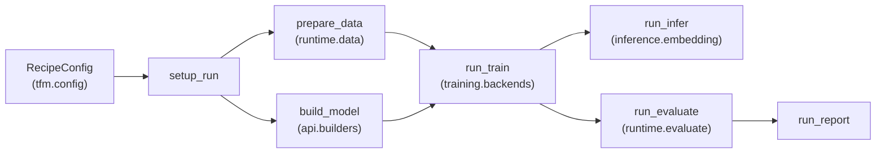

# Architecture overview

For maintainers: how the package is laid out, and what happens when a recipe
runs. What each slot means is in
[building blocks](../concepts/building-blocks.md); how to add to one is in the
[extension guide](extending.md).

## One run, one path

Every recipe, whatever its stack, runs through `tfm.runtime.pipeline`:

| Stage | Function | Reads | Writes |
|---|---|---|---|
| Load config | `tfm.config.load_recipe_config` | YAML | A validated `RecipeConfig`; unknown and removed keys raise |
| Data | `tfm.runtime.data.prepare_data` | Adapter, `data`, `features` | `PreparedData`: events, splits, `Cutoffs` with label windows, fitted tokenizer, train / validation / test batches |
| Model | `tfm.runtime.pipeline.build_model` | `model`, `objective`, `fraud_task` | A `TrxFM` (flat) or an experimental hierarchical model, after `validate_composition` |
| Setup artifacts | `setup_run` | | `resolved_config.yaml`, `data_validation_report.json`, `split_manifest.json`, `tokenizer_manifest.json`, `environment.json` |
| Train | `run_train` | `training` | `model.pt`, `checkpoint_manifest.json` (with the composition), `packing_manifest.json`, `train_log.json` |
| Infer | `run_infer` | | `embeddings.npz` (per side: vectors, labels, and customer, row, and event ids, row for row), `embeddings_manifest.json` |
| Evaluate | `run_evaluate` → `evaluate_run` | `fraud_task`, `evaluation` | `probe_manifest.json`, `finetune_manifest.json`, `metrics.json`, `metrics.md` |
| Report | `run_report` | | `model_card.md` |

`tfm <stage> --recipe <slug> [--config <variant>]` runs these stages
(`tfm.cli.recipe`), resolving the config from `recipes/catalog.yaml`; each
stage runs the ones before it. `--reuse-checkpoint` skips training when
`model.pt` exists.

## Package map

| Package | Owns | Must not |
|---|---|---|
| `tfm.contracts` | Typed, backend-neutral contracts: events, sequences, batches, outputs, errors, tokenizer protocol | Import anything else in `tfm` |
| `tfm.config` | The strict config schema | Hold behavior |
| `tfm.data` | Adapters, validation, labels and label windows, sequence builders, splits, collate | Know about models |
| `tfm.features` | Tokenizers and their layouts | Attach labels |
| `tfm.position`, `tfm.attention` | Position specs and attention kernels | Know about data |
| `tfm.compositions`, `tfm.layers` | Structure specs and the modules that implement them | Transform dataframes or read labels |
| `tfm.objectives` | Pretraining objectives, each declaring horizon, cutoff, gradient, and leakage checks | |
| `tfm.pooling`, `tfm.heads`, `tfm.adaptation` | Readouts, task heads, probes, fine-tuning | |
| `tfm.api` | `TrxFM`, config builders, `validate_composition` | Train |
| `tfm.training` | Trainers, backends, LoRA, checkpoints, precision | Know recipe layout |
| `tfm.inference`, `tfm.evaluation` | Embedding extraction, probes, metrics, reports | |
| `tfm.runtime` | Recipe orchestration only | Be imported by any package except `tfm.cli` |
| `tfm.experimental` | The public surface for experimental components | Be required by the core `tfm.__all__` |
| `tfm.extras` | Optional integrations behind capability checks (HuggingFace, FSDP2, RAPIDS) | Be imported at package import time |

## The batch is the seam

Tokenizers decide the batch; structures consume it. There are two batch
types:

- `TransactionBatch` (`tfm.contracts.batch`): one flat row of token ids per
  sequence, with an attention mask. Layouts `flat_fields` and
  `flat_key_value`. Consumed by `Flat`.
- `KeyValueTimeBatch` (`tfm.contracts.kvt`): `[rows, events, tokens]` key,
  value, and position ids, per-event masks and calendar, and `time_log` /
  `elapsed_log`. Layout `key_value_time`. Consumed by `ProfileHistory` and
  `ProfileEventDecoder`.

`tfm.data.collate.collate_batch` builds either one from any tokenizer and then
attaches what every stack needs: sequence-level fraud labels for a given
`LabelWindow`, the raw-feature vector for the `raw` probe arm, and ids for
alignment. Tokenizers never attach labels.

`tfm.adaptation.batching` slices either batch type by rows, which is how
probes, fine-tuning, and minibatching stay stack-agnostic.

## Where the rules live

| Rule | Enforced by | When |
|---|---|---|
| Config keys are real | `tfm.config._Strict` | Load |
| Keys apply to the chosen granularity | `GranularityConfig`, `RecipeConfig._cross_section_rules` | Load |
| Slot pairings (rules 1–3 of [building blocks](../concepts/building-blocks.md)) | `tfm.api.validation.validate_composition` | Model build |
| Layout carries the needed event boundary (rule 4) | `validate_tokenizer_layout` | `setup_run` |
| Backend can run this model, layout, device, and precision | `check_backend_for_run` (backend capabilities, ADR 0011) | Before and after data preparation |
| No future events, per-side labels, entity-disjoint probes | `tfm.data`, `tfm.runtime.evaluate` (ADR 0013) | Data and evaluation |

## Testing layers

| Directory | Proves | Runs on |
|---|---|---|
| `tests/unit` | Components in isolation | CPU |
| `tests/contract` | Public contracts: masks, causality, layouts, leakage, probe splits, backends | CPU; GPU cases skip by declared capability |
| `tests/recipe_smoke` | Every recipe runs end to end on synthetic data and writes its artifacts | CPU |
| `benchmarks/` | Recorded scaled runs; the only evidence for a claim | GPU |
