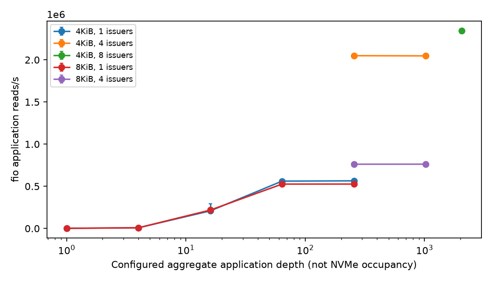
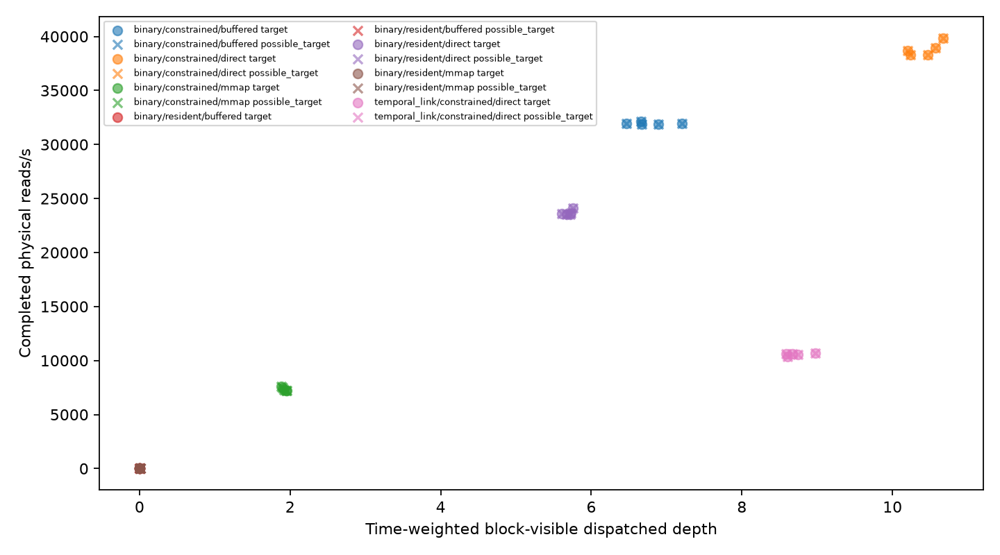
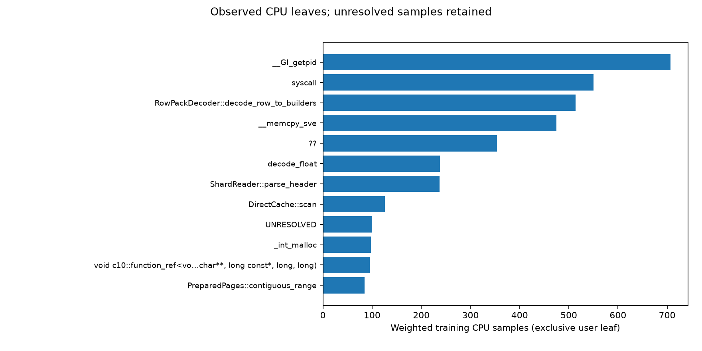

# DiskGraph native I/O readiness and saturation investigation

Buffered and Direct feed storage in bursts, despite allowing eight rings with
depth 256 each. The tested modes do **not demonstrate sustained NVMe saturation**. Cold Direct
training has a median 10.47 Linux-dispatched requests over the whole interval,
and no target requests dispatched for 85.08% of that interval (whole-device
zero-dispatched time is about 85.00%). During its busy
intervals the median depth is 69.64, with a time-weighted busy p95 of 268. The
configured capacity is therefore not evidence of sustained queue occupancy.

CPU decoding, repeated process-ownership guards, and feature/sampling
coordination are concrete next investigation targets. The evidence does not
identify one exclusive critical-path cause or quantify the speedup of removing
any one cost. Production rollout also needs a resolution for the confirmed
inherited external-sampler hang described below.

This report characterizes the pinned candidate; it does not establish a speedup
over current engine main. Its performance revision remains separate from later
rebases and functional validation of the proposed port. The [original proposal](https://github.com/kumo-ai/kumo-diskgraph/pull/424)
and [current core PR](https://github.com/NVIDIA/kumo-engine/pull/169) are distinct
from the frozen performance revision below.

## Measurements and clocks

The new, post-reboot evidence uses reproducible synthetic local workloads and
comprises 70 full application runs: five paired
`none`/`queue` repetitions for each configuration below; 80 read-only fio trials;
and separate full-work CPU and offCPU attribution runs. All work, prediction,
resource, observer, loss, diagnostic, drain, and source checks passed unchanged
frozen validators locally. Isolated archive replay is tracked separately in
[raw-artifacts.json](raw-artifacts.json).

Application rates count completed native Read/Readv SQEs after coalescing.
`mmap` bypasses that counter and is N/A. Physical rates count completed Linux
block requests in the exact kernel training window, not individual NVMe
commands. The following are medians of five runs; native and physical rates
come from the **same observed runs**. Target attribution is the lower bound;
possible-target and whole-device results are retained in the CSV.

| Workload | Mode | Native requests/s | Target physical reads/s | Mean dispatched depth | Target zero-dispatched time |
| --- | --- | ---: | ---: | ---: | ---: |
| Binary, constrained | Buffered | 214,696 | 31,944 | 6.67 | 89.71% |
| Binary, constrained | Direct | 38,715 | 38,718 | 10.47 | 85.08% |
| Binary, constrained | mmap | N/A | 7,260 | 1.92 | 14.68% |
| Binary, filesystem resident | Buffered | 226,829 | 0 | 0.003 | 99.94% |
| Binary, filesystem resident | Direct | 23,611 | 23,611 | 5.72 | 88.81% |
| Binary, filesystem resident | mmap | N/A | 0 | 0.005 | 99.90% |
| Temporal link, constrained | Direct | 10,591 | 10,593 | 8.67 | 93.43% |

Mean depth includes depth 0 and all operation types. Zero-dispatched time means
no Linux-dispatched requests in that attribution scope, not an observation of
the drive's internal idle state. Resident Buffered/mmap can have nonzero depth
from writes while completing no physical reads. Independent medians and the
different counter coverage and small kernel/native clock-boundary differences can make Direct physical rates
slightly exceed the native rate.

Constrained runs use 4 GiB memory; the configured Direct-cache budgets are 2 GiB for binary
and 1 GiB for temporal link. Resident binary uses 64 GiB memory and a 16 GiB Direct-cache
budget. Resident means filesystem pages were prewarmed and verified with
`mincore`; the Direct userspace cache was **not** prewarmed. Its physical reads
are consistent with the configured O_DIRECT path and fresh userspace cache,
not evidence of a cache defect or a warm-native-cache CPU ceiling. All runs use
zero DataLoader workers, Rayon 4, Torch 1, the same ten allowed CPUs, and full 1280 binary or 256
temporal-link training batches. Actual settings are in [metrics.json](metrics.json).

The unobserved binary training medians are 51.19 s Buffered, 58.32 s Direct and
331.93 s mmap when constrained; 48.13 s, 58.35 s and 37.12 s respectively when filesystem
resident. Temporal-link Direct is 69.59 s. These durations describe these specific
cache/workload configurations.

## Queue depth and the demonstrated storage path

| Constrained workload/mode (target scope) | Mean depth while busy | Whole-window p95 depth | Busy-window p95 depth | Mean completed read bytes |
| --- | ---: | ---: | ---: | ---: |
| Binary Buffered | 64.86 | 32 | 241 | 5,557 |
| Binary Direct | 69.64 | 70 | 268 | 5,292 |
| Binary mmap | 2.25 | 4 | 4 | 4,102 |
| Temporal-link Direct | 133.75 | 34 | 271 | 5,088 |

Each statistic is calculated per trial before taking its five-repeat median.
The retained depth histograms show high bursts: median observed maxima are 1047
Buffered, 623 Direct, 8 mmap and 802 temporal-link Direct. These are Linux block
depths; they cannot be equated with SQE capacity or controller-internal depth.
Cold Direct reads are about 72.63% in the [4, 8) KiB size bucket and 27.34% in [8, 16) KiB.
Fixed 4/8 KiB fio rates therefore are contextual demonstrations, not a precise
denominator for a hardware-utilization percentage.

Cold mmap has a different pattern: its low mean depth and p95 of 4 accompany
much less zero-dispatched time (14.68%). This shows limited block-level
parallelism rather than the explicit modes' long empty gaps. There is no
corresponding mmap CPU profile to identify its upstream limiting component.

The stable fio cells demonstrate about 2.344 million 4 KiB application reads/s
using either four batched issuers or eight issuers, and 762,269 8 KiB reads/s using
four issuers at configured depth 256 each. The single-issuer stable 4 KiB cell
reaches about 565,000 reads/s. Increasing issuer count at equal nominal aggregate
depth materially improves throughput, confirming that one issuer can limit
this path. However, **both complete curves are classified
`INCONCLUSIVE_VARIABILITY`** by the unchanged classifier. No absolute device
ceiling or percentage of a vendor maximum is established.

fio's application counts, configured outstanding depth and completion latency
have different definitions from the BPF block counts, dispatched depth and
first-issue-to-final latency. Coarse whole-device fio snapshots also include
setup, ramp and foreign traffic. All counts and windows are retained rather
than silently relabelled as NVMe commands.

## CPU and coordination evidence

Both attribution runs use constrained binary Direct; their hotspots must not
be assigned to Buffered or mmap without profiling those modes. The CPU run has
6132 weighted training samples across 19 TIDs at 99 Hz per CPU.
The 54.717 s kernel training window accounts for 63.151 target-cgroup CPU-seconds, or
1.154 average accounted CPU cores. Sample-estimated CPU is 61.939 s. The sampler
reported no truncation; unresolved exclusive leaves remain visible.

`getpid` appears in 707 samples (11.53%), all with a getpid user leaf. Of those,
575 have any resolved kernel stack, while 65 specifically contain a getpid
kernel symbol; these are overlapping classifications, not extra samples.
Immediate observed callers reconcile to 391 contiguous-range accesses, 48
append-range accesses, 4 copy-range accesses, 122 prepared-page drops, 62 finishes,
18 sampling calls, 3 feature calls, and three other individual calls. The
remaining 56 samples terminate at generic thread roots and remain source
unattributed even though the frames have names. Every TID/caller weight is
retained in [getpid-caller-tids.csv](tables/getpid-caller-tids.csv).

Measured source confirms that cached-range access reaches the process check
through `PreparedPage::valid`/`CacheLease::valid`; guards also protect response
finish, destruction and process state. These checks protect fork ownership and
`MADV_DONTFORK` mappings. The observed 11.53% is **not** a predicted speedup or a
syscall count, and the exact inlined guard inside some finish/drop stacks cannot
be resolved from these samples.

The separate offCPU run spans 59.143 s of training. Actual model-main PID 431802
blocks 25.504 s and is runnable/preempted for 0.0122 s; wrapper gate PID 431784 blocks
59.085 s and must not be mistaken for the training main thread. Disjoint blocked
model-main stack groups total 20.727 s in Rayon latch waits with feature
accumulation and 4.685 s in prepared-page batch-finish contexts; the groups have
no intersection and exclude runnable time. Worker intervals overlap. A futex or
Rayon wait identifies a coordination point, not whether its critical worker is
decoding, executing a guard, or waiting for storage. Separate CPU/offCPU runs
cannot be aligned or added as one timeline.

## Observer and thermal qualification

Queue observation changes the fit-through-first-prediction end-to-end clock by
between -6.08% and +11.88% across the 35 pairs; cold Direct's range is +3.28% to
+11.88%. These are observed paired differences, not confidence intervals or an
overhead correction factor. Training and end-to-end deltas for **every pair**
are in [paired-observer-overhead.csv](tables/paired-observer-overhead.csv).
Physical rates describe instrumented runs and should be interpreted with this
qualification prominently in view.

All 80 fio trials retain before/after SMART snapshots, including transition
counts and accumulated thermal-duration counters. Recorded temperatures span
311–333 K. Warning/critical duration and thermal transition/time counters have
zero deltas; no media or error-log increments were recorded. Snapshot peaks
between observations are unobserved, so this does not prove absence of thermal
performance effects. Every numeric before/after/delta is published in
[fio-thermal-counters.csv](tables/fio-thermal-counters.csv).

## Production action items

1. **Resolve inherited external-sampler hangs before production rollout in
   that topology.** Four fresh-child controls passed; four cases inheriting an
   external `SamplerEngine` timed out after 15 s (mmap/Direct×cold/warm), with all
   children positively reaped. Construct the engine in each worker or reject
   inherited use at the public boundary, then add the actual parallel-history
   regression. This API predates the port; a regression introduction is not
   proven without a baseline comparison. The repeated final probe uses source/native build
   acaa797a (SO SHA 4437578a…), separately from measured 75ca0e2f/SHA a5949f96….
   Its local acceptance proof is SHA c05170ba…; Rust 1.99.1 CI on that updated
   core revision is a separate qualification from these frozen measurements.
2. **Test guard amortization while preserving fork safety.** Use the complete
   getpid caller/TID inventory to target cached-range access. Preserve
   access/response/drop/process-state checks and `MADV_DONTFORK` behavior;
   cached or thread-local PIDs must not survive a fork unchecked. Acceptance
   needs current seeded work/prediction parity, fork tests and a new paired
   profile showing where time moved.
3. **Separate feature/decode work from batch feeding.** Run focused decode and
   bounded concurrency experiments with the same rows, seed, training work,
   predictions, cache and memory limits. Measure main/worker CPU and waits,
   physical dispatch duty cycle and end-to-end time. Bound worker overlap explicitly;
   the observed 1.154 average CPU cores does not establish host CPU saturation.
   A fuller queue alone is not success if fit/predict time regresses.
4. **Treat the storage ceiling as unresolved.** Repeat the variable curve
   cells and compare matched read-size/pattern windows before claiming a
   controller/media ceiling. Preserve issuer-CPU and all thermal counter/time
   evidence. Do not express current results as a percentage of advertised max.
5. **Keep observer interference explicit.** Use a finite, quiet capture window
   and all five paired controls for follow-ups. Report both training and
   fit/first-predict effects; do not suppress negative differences or choose a
   numeric overhead cutoff after seeing results.

Separate local validation of rebased core acaa797a passed 2191 Rust tests
(28 ignored), 10 strict native cases, three backend empty-node cases, 60 Python
runtime cases, three oversized-row backend cases, and eight task tests across
24 fresh backend processes. Its native binary was not used for these
performance measurements. Exact-head Rust 1.99.1 CI passed 2194 workspace
tests (28 ignored), 10 strict native tests and 931 generic Python tests
(20 opt-in skips, one deselected). The CPU job passed eight task tests
across 24 backend executions and 15 strict Python tests. macOS passed an
optimized wheel build/install and 11 mmap smoke tests. The complete
[Testing workflow](https://github.com/NVIDIA/kumo-engine/actions/runs/44444017807)
finished successfully: 55 successful jobs and one skipped. The closed
CI receipt (SHA 09e01345…) is retained separately from measured inputs.

These are focused follow-ups rather than speculative port fixes. No production
code was changed to make the measurements pass. Detailed acceptance criteria
and evidence references are in [action-items.json](action-items.json).

## Reproduction and retained failures

The measured candidate is 0fe02c1b, native source 75ca0e2f, SO SHA a5949f96…, and
frozen tools dcef73da. Native SO and ingest rebuilt byte-identically; the new
wheel container has a new hash. Source Parquet regenerated byte-identically;
prepared UUIDs changed, and all nine full-work pilots and new-epoch correctness
oracles were qualified. Old lost raw runs and pilot timings are not
pooled into these results. See [inputs.json](inputs.json),
[reproduction-plan.json](reproduction-plan.json), [metrics.json](metrics.json)
and [raw-artifacts.json](raw-artifacts.json).

The first principal capture remains failed: the application completed, but
strict final quiet/drain timed out amid foreign read traffic. Optional artifact
walking/import work was running on the host; its exact causal PID attribution
is not proven. A fresh 70-run attempt used a 60 s final-drain allowance instead of
10 s, retained the same strict 1 s quiet requirement, and silenced optional host
I/O. The drain is outside both reported clocks. The failed attempt is retained
and never resumed or counted as a successful measurement. Qualification v1's
target-owned DATA-token requirement is likewise retained as failed: DATA tokens
were root-owned, and the parent-dirtied write fixture separately retained parent
BIO ownership. V2 creates/dirties its write file inside the payload and verifies
owned reads/writes, PID-bound empty flushes and globally balanced DATA chains
separately, without attributing those global chains to the owned writes.
